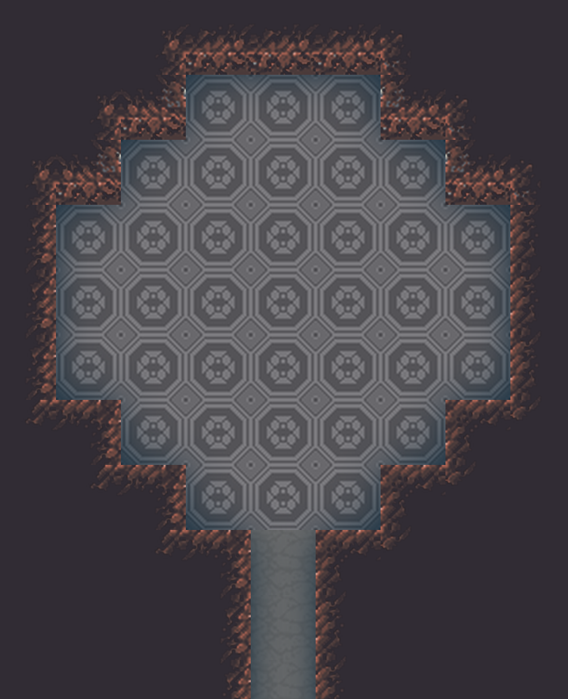
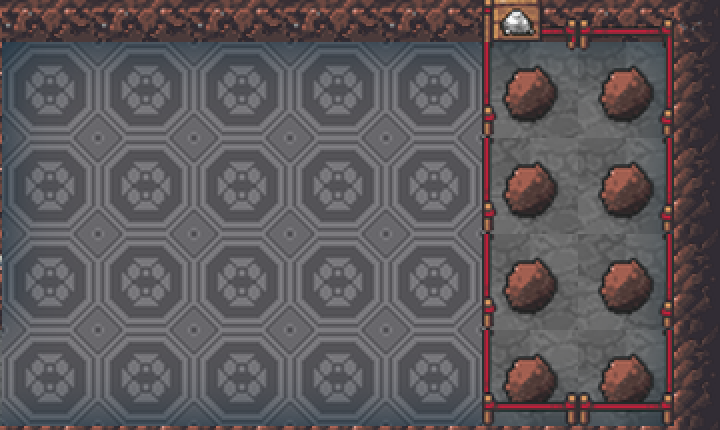
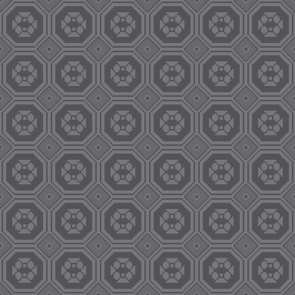
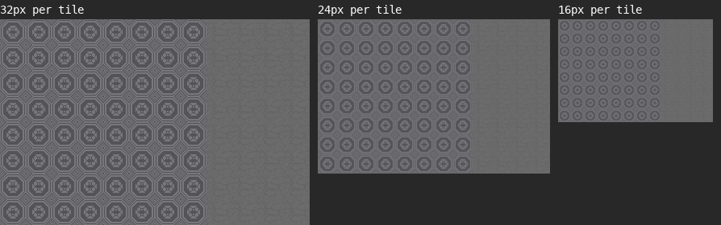

# Lavishly Engraved Floors

A graphics mod for Dwarf Fortress (Steam / Premium) that replaces the vanilla engraved floor, the
dwarf face, with a seamless octagon lattice carrying a small quatrefoil boss. The tile is drawn in the
four greys of the Dark Floors stone, so an engraved room reads as one continuous carved floor that
matches the surrounding smoothed stone.

Next to a stockpile on rough stone:

## The engraving

| Single tile (8x) | Tiled (3x) |
|---|---|
|  |  |

The band and emblem sit on the darkest grey and the octagon field on the lightest, so the pattern
keeps reading as rings when the map is zoomed out:

## What it changes

- `FLOOR_STONE_ENGRAVED_PALETTE` and `FLOOR_STONE_ENGRAVED_NON_PALETTE`: the new engraving.
- `STONE_FLOOR_1` to `STONE_FLOOR_9`, `STONE_FLOOR_5B` to `5D` and `SMOOTH_FLOOR`: the Dark Floors
  grey stone sheet, with the smooth floor's cracks one grey level stronger than the original.

Graphics only. It can be added to or removed from an existing world without affecting the save.

## Install

Subscribe on the [Steam Workshop](https://steamcommunity.com/sharedfiles/filedetails/?id=3836534634), or install manually:

- Steam Workshop: subscribe, then add the mod when creating a new world (or via the mod manager for
  an existing one).
- Manual: copy this folder to `Dwarf Fortress/mods/lavishly_engraved_floors/` and pick it in the
  mod list when generating a world.

Load it after any other mod that changes stone floors if you want its floor sheet to win.

## Credits

- Mod structure and the Dark Floors stone sheet come from
  [Sumptuously Engraved Floors](https://steamcommunity.com/sharedfiles/filedetails/?id=3429443204)
  by FeralFerret, whose tile was in turn inspired by Kruggsmash's Northbridge series.
- Engraving design and pixel work by vaneyckt7.
